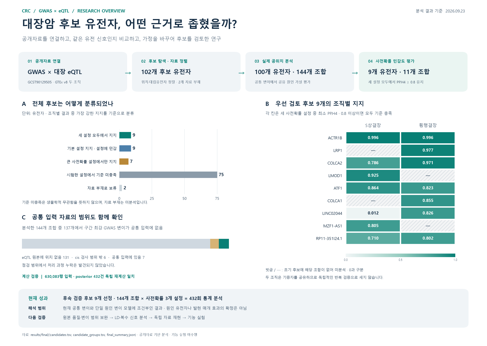

# 대장암 GWAS·eQTL 기반 유전자 후보 탐색

**공개 유전체 자료를 수집·정렬하고, 통계 결과를 독립 계산으로 검증한 R·Python 분석 프로젝트입니다.**

대장암 GWAS와 대장 조직 eQTL의 신호가 원인 변이를 공유하는지 `coloc`으로 평가했습니다. 자료 확보부터 QC·대립유전자 정렬, 사전확률 민감도 분석, 누락 원본 대조, 최종 후보표·보고서 작성까지 연결했습니다.

| 분석 규모 | 결과 검증 | 후속 검토 후보 |
|---|---|---|
| **100개 유전자 · 144개 조합** | **432회 분석을 별도 Python 계산으로 대조** | **9개 유전자 · 11개 조합** |
| 초기 후보 102개·147개 조합을 모두 추적 | posterior 최대 절대 차이 약 **5×10⁻¹⁶** | 시험한 세 사전확률 모두에서 PP.H4 ≥ 0.8 |

**분석 기준일: 2026-09-23.** 후보는 현재 자료·모델에 조건부인 탐색적 결과입니다. 144개 분석 조합 중 137개에서 정제 구간의 최강 GWAS 변이가 공통 입력에 없어 해석 범위를 제한했습니다. 원인 유전자 확정이나 독립·기능 검증을 의미하지 않습니다.

[최종 보고서](reports/final_report.md) · [한 장 요약 PDF](reports/overview/research_overview.pdf) · [전체 후보표](results/final/candidates.tsv) · [재분석 안내](#실행-환경과-재분석)



## 핵심 작업과 확인 근거

| 작업 | 구현·확인 내용 | 근거 |
|---|---|---|
| 공개 자료 수집 | GWAS·GTEx 구간 통계 확보, 출처·자료 가용성 기록 | [수집 코드](scripts/acquire_regional_sumstats.py) · [확보 기록](docs/DATA_ACQUISITION.md) |
| 분석 입력 정렬 | 좌표·대립유전자 정렬, 중복·결측 QC, 공통 입력 구성 | [정렬 코드](scripts/harmonize_regional_sumstats.py) · [QC·정렬 기준](docs/DATA_HARMONIZATION.md) |
| 통계 분석·독립 검증 | `coloc` 3개 prior 설정과 Python ABF·H0–H4 재계산 | [R 실행 코드](scripts/05_run_real_coloc.R) · [Python 검증 코드](scripts/report_real_coloc.py) · [검증 수치](results/final/final_summary.json) |
| 후보 추적·보고 | 미분석 후보도 보존, 원본 누락 대조, 후보별 제한과 보고서 기록 | [최종 후보표](results/final/candidates.tsv) · [누락 점검](docs/PREVIOUS_STAGE_AUDIT.md) · [최종 검증 기록](results/final/final_validation.json) |

## 연구 질문과 자료

> 대장암 감수성과 연관된 유전 신호는 대장 조직의 유전자 발현 조절 신호와 원인 변이를 공유하는가?

|항목|사용 자료·설정|
|---|---|
|대장암 GWAS|GWAS Catalog `GCST90129505` · 유럽·동아시아 메타분석|
|대장 조직 eQTL|GTEx v8 `Colon_Sigmoid`(S상결장), `Colon_Transverse`(횡행결장)|
|유전체 좌표|GRCh38|
|초기 후보 선정|유의한 GWAS 변이(p ≤ 5×10⁻⁸)와 유의한 cis-eQTL의 직접 중첩|
|공위치 분석|`coloc::coloc.abf` · 형질별 구간 내 최대 하나의 원인 변이 가정|
|민감도 분석|요청 p1=p2=10⁻⁴, p12=10⁻⁶·10⁻⁵·10⁻⁴ · PP.H4 ≥ 0.8을 운영 기준으로 사용|

분석 흐름은 **공개자료 수집 → 초기 후보 탐색 → 구간 요약통계 확보 → QC·대립유전자 정렬 → 공위치·민감도 분석 → 누락 점검·후보 정리**입니다. 공위치 분석에는 유의성 필터를 적용하지 않은 구간 통계를 사용했습니다. 자료 버전·출처·이용 조건은 [자료 출처](docs/SOURCES.md)와 [확보 기록](docs/DATA_ACQUISITION.md)에 정리했습니다.

## 핵심 결과

|분석 단계|결과|
|---|---:|
|초기 탐색의 유의한 단일 rsID|174개 · GTEx 매핑 169개, 미매핑 5개|
|초기 후보|102개 유전자 · 후속 대상 147개 유전자–조직 조합|
|실제 공위치 분석|100개 유전자 · 144개 조합|
|정렬한 공통 통계|630,083행 · 유전자·조직별 반복 포함|
|사전확률 3개 설정의 계산|432회 · 전체 posterior를 별도 Python 계산으로 대조|
|기본 설정에서 PP.H4 ≥ 0.8|18개 유전자 · 23개 조합|
|세 설정 모두에서 PP.H4 ≥ 0.8|9개 유전자 · 11개 조합|

원래 후보 102개와 대상 조합 147개를 모두 보존해 다음과 같이 분류했습니다.

|분류|유전자|유전자–조직 조합|
|---|---:|---:|
|A · 세 설정 모두에서 지지 · 자료 제한에 조건부|9|11|
|B · 기본 설정에서 지지하지만 설정에 민감|9|12|
|C · 큰 사전확률 설정에서만 지지|7|8|
|D · 시험한 설정에서 기준 미충족|75|113|
|E · 자료 부재로 분석 보류|2|3|

세 설정에서 지지를 유지한 유전자는 **ACTR1B, LRP1, COLCA2, LMOD1, ATF1, COLCA1, LINC02044, MZF1-AS1, RP11-351I24.1**입니다. 유전자별 분류는 가장 강한 지지를 보이는 조직 조합을 요약하며, 조직별 posterior를 합산하지 않습니다.

## 결과·발표 자료 찾아보기

|목적|자료|
|---|---|
|연구를 한눈에 보기|[한 장 요약 PNG](reports/overview/research_overview.png) · [PDF](reports/overview/research_overview.pdf)|
|최종 결과와 해석 확인|[최종 보고서 Markdown](reports/final_report.md) · [HTML](reports/final_report.html)|
|후보별 수치 확인|[전체 102개 유전자](results/final/candidates.tsv) · [147개 조합·효과 방향·제한](results/final/candidate_groups.tsv)|
|공위치 분석 근거 확인|[방법·결과 문서](docs/COLOC_RESULTS.md) · [검색 가능한 HTML 보고서](reports/coloc_report.html)|
|사전확률 민감도 보기|[우선 후보 11개 조합의 그림 PNG](reports/final_candidate_sensitivity.png) · [PDF](reports/final_candidate_sensitivity.pdf)|
|처음 보는 사람에게 설명|[6쪽 소개 PDF](reports/introduction/research_intro.pdf) · [웹 문서](reports/introduction/research_intro.html) · [3분 설명문](reports/introduction/research_intro_script.md)|
|발표 자료 활용|[연구 발표 PowerPoint](reports/presentation/GWAS_First_Lab_Presentation_CRC_completed.pptx)|
|초기 중첩 탐색 확인|[초기 보고서](reports/public_report.html) · [변이별 근거표](results/public/variant_gene_evidence.tsv)|

GitHub에서는 Markdown·PNG·PDF를 바로 살펴볼 수 있습니다. HTML 보고서는 저장소를 내려받은 뒤 브라우저에서 열면 표 검색과 상대 경로 링크를 사용할 수 있습니다.

## 해석할 때 확인할 점

- **변이 관측 범위:** 분석한 144개 조합 중 137개에서 정제 구간의 최강 GWAS 변이가 공통 입력에 없습니다. 원본 점검에서 131개는 eQTL 원본에 위치가 없었고 6개는 해당 유전자의 cis 검사 범위 밖이었습니다. 점검 범위에서 처리 과정 누락은 발견되지 않았습니다.
- **모델과 정렬 범위:** 구간은 lead ±500 kb를 합친 탐색적 거리 창입니다. LD·복수 신호를 모델링하지 않았으며, 모호한 A/T·C/G SNP와 indel을 제외했습니다. 원본의 극단적 효과크기 등 추정 품질도 후속 확인이 필요합니다.
- **미분석과 재현의 구분:** X염색체 GWAS 자료가 없는 SHROOM2·GPR143의 3개 조합은 보류했습니다. 두 대장 조직은 기증자를 공유하므로 독립 재현으로 세지 않습니다.
- **후보 선정의 범위:** 유의 변이·eQTL 중첩에서 출발한 후보 분석입니다. 등급 D는 생물학적 무관함을 뜻하지 않으며, PP.H4 기준은 전체 유전자 수준 FDR이나 발현의 인과적 매개 효과가 아닙니다.

세부 근거는 [공위치 분석 해석](docs/COLOC_RESULTS.md), [전 단계 누락 점검](docs/PREVIOUS_STAGE_AUDIT.md), [미해결 항목](results/final/issue_ledger.tsv)에 있습니다. 후속 과제는 자료 관측 범위·원본 품질 보완, 집단에 적합한 LD·복수 신호 분석, 독립 자료 재현과 기능 검증입니다.

## 실행 환경과 재분석

모든 명령은 프로젝트 루트에서 실행합니다. 아래는 **Rscript가 PATH에 등록된 Windows PowerShell** 예시이며, Python 명령은 `py`를 사용합니다. RStudio에서도 환경 준비 후 `crc-gwas-eqtl.Rproj`를 열고 분석용 R 스크립트를 `source()`로 실행할 수 있습니다.

|구성|필요 조건|
|---|---|
|R 분석|R · `jsonlite`, `coloc`, `digest` · 기존 기록 환경은 R 4.6.1 / coloc 5.2.3|
|Python 보고·검증|Python 3.11 이상 · 기본 보고·자료 처리 스크립트는 표준 라이브러리 사용|
|한 장 요약 그림 생성|`matplotlib`, `numpy` · 맑은 고딕 등 생성 코드가 지원하는 한글 글꼴|
|원본 자료 재수집|네트워크와 `curl.exe` · 기존 결과 열람·정제 자료 재분석에는 불필요|

GitHub Actions는 `main` 푸시, PR, 수동 실행 시 합성 자료로 두 가지 검사를 수행합니다. [Python 단위 테스트](.github/workflows/python-tests.yml)는 Ubuntu의 Python 3.11·3.14에서 실행하고, [R 입력·정렬 검사](.github/workflows/r-tests.yml)는 Ubuntu의 R 4.6.1에서 입력값과 대립유전자 정렬을 확인합니다. 로컬에서 `coloc`를 설치한 뒤 같은 R 테스트 명령을 실행하면 공위치 분석 입력의 전체 구간과 유전체 빌드 검사도 수행합니다.

<details>
<summary>환경 설치와 단계별 재분석 명령 펼치기</summary>

### 1. 환경 준비

```powershell
Rscript --vanilla scripts/setup.R --coloc
Rscript --vanilla -e "source('R/bootstrap.R'); if (!requireNamespace('digest', quietly=TRUE)) install.packages('digest', lib=.libPaths()[1])"
```

`setup.R --coloc`는 `jsonlite`와 `coloc`를 준비하며, 두 번째 명령은 실제 자료 실행에 필요한 `digest`를 보완합니다. R 패키지는 프로젝트의 `.Rlib/`와 기존 라이브러리를 사용합니다. 버전은 `logs/package_versions.csv`와 실행별 `sessionInfo.txt`에 기록하지만 lockfile로 고정하지는 않습니다. 초기 설치에는 네트워크가 필요합니다.

Rscript가 PATH에 없다면 설치된 경로로 바꾸어 실행하세요. 예: `& 'C:\Program Files\R\R-4.6.1\bin\Rscript.exe' --vanilla scripts/setup.R --coloc`.

### 2. 저장된 자료로 초기 후보 탐색 재실행

```powershell
Rscript --vanilla run.R --offline
```

이 명령은 캐시를 읽는 `01_fetch_public.R`과 후보표를 만드는 `02_analyze_public.R`을 실행해 `results/public/`과 초기 보고서를 갱신합니다. 실제 공위치 분석이나 최종 보고서까지 실행하는 명령은 아닙니다. `--offline`을 빼면 없는 API 캐시만 내려받고 기존 캐시는 재사용합니다.

### 3. 정제 구간 통계로 실제 공위치 분석 재실행

```powershell
Rscript --vanilla scripts/05_run_real_coloc.R
py scripts/report_real_coloc.py
```

저장소에 포함한 `data/processed/acquisition/`과 `data/processed/harmonization/`의 정제 자료를 사용합니다. 필요한 패키지가 있으면 추가 다운로드 없이 실행할 수 있습니다. 첫 명령은 `results/coloc/<실행시각>_real/`에 새 실행을 저장하고, 두 번째 명령은 posterior를 독립 검증한 뒤 공위치 보고서를 갱신합니다. 실행 위치는 `results/coloc/latest_real_run.txt`에 기록됩니다. 최종 후보표·최종 보고서는 이 명령으로 자동 갱신되지 않으며, 아래의 별도 실행 안내를 따릅니다.

기본 연구·조직·기준은 [config.R](config.R)에 있습니다. 초기 유의 변이 중첩표인 `results/public/`은 공위치 분석 입력이 아닙니다. 별도 자료를 분석하려면 [입력 규격](docs/DATA_DICTIONARY.md)과 [metadata 예제](data/input/metadata.example.R)를 확인하고 `scripts/04_run_coloc.R`을 사용하세요.

### 4. 한 장 연구 요약 그림 다시 만들기

```powershell
py -m pip install matplotlib numpy
py scripts/plot_research_overview.py
```

보존된 최종 후보표를 읽어 `reports/overview/research_overview.png`와 PDF를 갱신합니다. 공위치 분석을 새로 수행하는 명령은 아닙니다.

### 5. 그 밖의 재현·검증

|작업|실행 안내|
|---|---|
|원본 구간 자료·발현 SD 재수집|[자료 확보](docs/DATA_ACQUISITION.md)|
|QC·대립유전자 정렬 재생성|[기준 정렬](docs/DATA_HARMONIZATION.md)|
|원본 누락 점검·최종 보고서 재생성|[최종 보고서 실행 순서](docs/FINAL_REPORT.md)|
|R 입력·정렬 점검|`Rscript --vanilla tests/run_tests.R`|
|Python 단위 테스트|`py -m unittest discover -s tests -p 'test_*.py'`|

새로 복제한 저장소에는 대용량 원본 캐시 `data/raw/summary_statistics/`와 비압축 `results/coloc/*/harmonized.tsv`가 없습니다. 정제 자료를 이용한 위 재분석은 가능하지만, **원본 누락 감사와 기존 전체 해시 검증에는 제외 파일의 복구·재생성이 필요**합니다. 구간 원본·발현 자료의 오프라인 수집은 해당 원본 캐시가 이미 있을 때만 가능합니다. `results/demo/`는 합성 자료 결과이며 실제 후보표에 포함하지 않습니다.

</details>

## 저장소 구성

|경로|내용|
|---|---|
|`R/`, `config.R`, `run.R`|공통 함수, 분석 설정, 초기 탐색 실행기|
|`scripts/`|자료 수집·정렬·분석·검증·보고서와 그림 생성|
|`data/raw/`|공개 API 캐시와 출처 기록 · 대용량 구간 캐시는 제외|
|`data/processed/`|후보 탐색 자료, 구간 통계, 정렬 결과와 체크섬|
|`data/input/`|사용자 구간 요약통계 입력 위치와 metadata 예제|
|`results/public/`, `results/coloc/`, `results/final/`|초기 후보, 실제 공위치 실행, 최종 후보·감사 기록|
|`reports/`|최종 보고서, 연구 요약 그림, 소개 자료와 발표 자료|
|`docs/`, `tests/`, `logs/`|방법·출처·실행 문서, 오류 방지 점검, 실행 환경 기록|

코드·보고서·후보표·재현 기록을 공개하며, 대용량 원본의 출처와 체크섬은 보존합니다. 포함·제외 파일과 복구 경로는 [GitHub 공개 범위](docs/GITHUB_PUBLICATION.md), 연구 설계와 후속 과제는 [분석 계획](docs/ANALYSIS_PLAN.md)에 정리했습니다.

